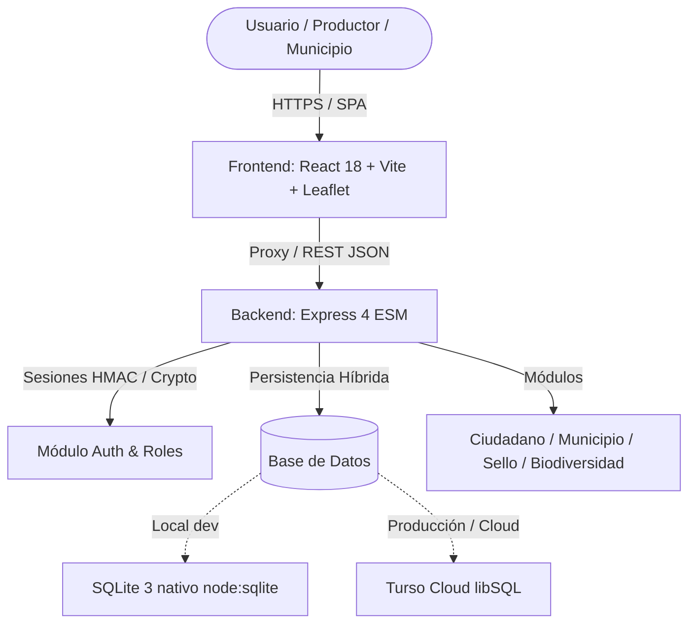

# 🍯 Néctar LatAm

> **Plataforma comunitaria de conservación de polinizadores nativos y agroecología en Latinoamérica.**  
> *"Un modelo, mil paisajes. Una red, todo un continente."*

[](https://nodejs.org/)
[](https://react.dev/)
[-black.svg?logo=express)](https://expressjs.com/)
[](https://turso.tech/)
[](https://leafletjs.com/)
[](https://vercel.com/)
[](./LICENSE)

---

## 📌 Tabla de Contenidos

1. [Visión General del Proyecto](#-visión-general-del-proyecto)
2. [Arquitectura y Stack Tecnológico](#-arquitectura-y-stack-tecnológico)
3. [Módulos de la Plataforma](#-módulos-de-la-plataforma)
4. [Estructura del Repositorio](#-estructura-del-repositorio)
5. [Instalación y Puesta en Marcha](#-instalación-y-puesta-en-marcha)
6. [Variables de Entorno y Base de Datos](#-variables-de-entorno-y-base-de-datos)
7. [Referencia de la API REST (v1)](#-referencia-de-la-api-rest-v1)
8. [Autenticación, Seguridad y Roles](#-autenticación-seguridad-y-roles)
9. [Despliegue en Producción (Vercel)](#-despliegue-en-producción-vercel)
10. [Países y Cobertura Regional](#-países-y-cobertura-regional)
11. [Créditos y Licencia](#-créditos-y-licencia)

---

## 🐝 Visión General del Proyecto

En América Latina, la pérdida de hábitat, la deforestación y el uso intensivo de agroquímicos amenazan a las abejas nativas sin aguijón (*meliponas*), abejas solitarias, colibríes y mamíferos nectarívoros, cuya actividad sostiene hasta el 75% de los cultivos alimentarios esenciales (café, cacao, aguacate, frutales).

**Néctar LatAm** es una solución tecnológica integral y de código abierto que articula a **productores agrícolas**, **comunidades locales**, **científicos ciudadanos** y **gobiernos municipales** mediante:
- **Asistencia bioclimática inteligente:** generación automatizada de planes de paisaje, selección de flora nativa y tipología de nidos según el piso altitudinal y coordenadas.
- **Ciencia ciudadana y monitoreo:** georreferenciación de espacios y registro fotográfico de avistamientos de polinizadores.
- **Gamificación comunitaria:** acumulación de puntos, distintivos de conservación y ranking colectivo.
- **Gobernanza municipal:** cuadro de mando (*dashboard*) territorial con mapas interactivos de conectividad ecológica.
- **Economía solidaria y certificación:** Sello *"Polinizador Amigo"* con trazabilidad por código QR y microadopción de metros cuadrados de hábitat floral.

---

## 🏗 Arquitectura y Stack Tecnológico

El proyecto está organizado como un **monorepo fullstack** desacoplado, optimizado para ejecutarse tanto en desarrollo local como en arquitecturas *serverless* multi-instancia:



### Componentes Principales

| Capa | Tecnologías | Propósito |
|---|---|---|
| **Frontend** | React 18, TypeScript, Vite 5, React Router 6 | Interfaz web SPA rápida, reactiva y accesible. |
| **Mapas** | Leaflet, OpenStreetMap, react-leaflet hooks | Selector interactivo de coordenadas (`LocationPicker`) y mapa de espacios/calor (`MapView`). |
| **Estilos & UI** | CSS Puro con Design Tokens (`tokens.css`, `components.css`) | Paleta orgánica oficial: Verde bosque (`#1b533a`), Amarillo miel (`#facc15`), Marfil (`#f7f6f0`) y Tinta (`#142017`). Sin dependencias pesadas de UI. |
| **Backend** | Node.js (24.x recomendado, >= 20.x), Express 4 (ESM), Morgan, CORS | API REST robusta, modular (controladores, repositorios, servicios y middlewares) y respuestas 100% en formato JSON. |
| **Persistencia** | Dual: `node:sqlite` (local) + `@libsql/client` (Turso Cloud) | Base de datos relacional con esquema jerárquico (`País > Municipio > Polinizador`). |
| **Seguridad** | `node:crypto` (`scrypt` + firmas HMAC-SHA256) | Hashing con sal para usuarios y tokens de sesión autocontenidos (stateless), resistentes a reinicios de contenedores serverless. |
| **Hosting** | Vercel | Monorepo con despliegue unificado o servicios separados mediante `vercel.json` e `index.js`. |

---

## 📦 Módulos de la Plataforma

### 1. 🌿 Néctar Ciudadano
* **Asistente de Segmentación en 5 Pasos (`/segmentacion`):**
  1. *Ubicación geográfica:* selección interactiva de país, departamento/municipio y punto exacto sobre mapa Leaflet.
  2. *Tipo de espacio:* finca agrícola, patio/jardín, terraza/balcón, escuela, parque/rotonda o área comunal.
  3. *Vegetación o cultivo:* café, cacao, frutales, hortalizas, plantas ornamentales o sin cultivo.
  4. *Piso altitudinal:* cálido seco (0-500 msnm), cálido húmedo (0-800 msnm), templado (800-1500 msnm) o frío (1500+ msnm).
  5. *Plan personalizado:* asignación automática de polinizadores focales, 5 a 8 plantas nativas recomendadas con calendario de floración, especificación de nidos/hoteles de abejas y 10 puntos de bienvenida.
* **Directorio de Espacios (`/espacios` y `/espacios/:id`):** consulta de fichas técnicas con mapa de ubicación, historial de monitoreo y detalle agroecológico.
* **Monitoreo de Campo (`/monitoreo`):** formulario para reportar avistamientos de insectos, aves o mamíferos, validación de evidencia fotográfica y herencia de coordenadas del espacio registrado (+15 puntos).
* **Gamificación y Ranking (`/ranking`):** tabla de posiciones comunitaria, cálculo dinámico de niveles y condecoraciones.

### 2. 🏛 Néctar Municipio (`/municipio`)
* Panel de control territorial diseñado para alcaldías y técnicos ambientales.
* Catálogo de municipios organizado por países de la región.
* Indicadores clave (KPIs): espacios registrados, prácticas agroecológicas implementadas, avistamientos verificados y certificaciones.
* Mapa satelital/topográfico de dispersión territorial para priorizar corredores biológicos e intervenciones de conservación.

### 3. 🏷 Néctar Sello — "Polinizador Amigo" (`/sello`)
* **Directorio de Productores Certificados:** vitrina pública de fincas comprometidas con la eliminación de agroquímicos tóxicos y preservación de parches florales.
* **Verificación Pública QR (`/sello/verificar/:slug`):** ficha de trazabilidad accesible por los consumidores escaneando el empaque del producto.
* **Adopción de Hábitats:** pasarela solidaria para que ciudadanos y empresas adopten metros cuadrados de refugio floral, financiando kits de siembra y capacitación campesina.

### 4. 📚 Biodiversidad y Catálogo Néctar (`/especies` y `/polinizadores`)
* Catálogo botánico de plantas nativas nectaríferas por país y piso climático.
* Catálogo faunístico especializado en polinizadores nativos:
  - **Abejas sin aguijón (Meliponini):** *Melipona beecheii*, *Tetragonisca angustula*, *Scaptotrigona*, *Trigona fulviventris*, etc.
  - **Abejas solitarias:** *Xylocopa*, *Centris*, *Manuelia postica*, etc.
  - **Aves nectarívoras:** Colibríes (*Trochilidae*).
  - **Mamíferos nectarívoros:** Murciélagos glosofaginos (*Glossophaga soricina*) y marsupiales nativos (*Monito del monte*).

---

## 📂 Estructura del Repositorio

```text
Nectar/
├── backend/                  # API REST Express (ESM)
│   ├── db/                   # Scripts SQL y base SQLite local
│   │   ├── schema.sql        # Esquema de tablas, índices y vistas
│   │   ├── seed.sql          # Datos iniciales (países, municipios, polinizadores)
│   │   └── nectar.sqlite     # Base local SQLite (generada al iniciar)
│   ├── src/
│   │   ├── app.js            # Configuración de Express, middlewares y rutas
│   │   ├── server.js         # Arranque del servidor HTTP (puerto 3000 por defecto)
│   │   ├── controllers/      # Controladores de peticiones HTTP
│   │   ├── routes/           # Definición de rutas v1 de la API
│   │   ├── services/         # Lógica de negocio (auth, conectividad, gamificación, etc.)
│   │   ├── repositories/     # Consultas y acceso a la capa de datos
│   │   ├── data/             # Datos base en memoria y catálogos
│   │   ├── middleware/       # Middlewares de autenticación y validación
│   │   └── utils/            # Normalización de texto, validadores y helpers
│   └── package.json
├── frontend/                 # Aplicación SPA (React 18 + Vite + TS)
│   ├── public/               # Recursos estáticos
│   ├── src/
│   │   ├── App.tsx           # Enrutamiento principal y guards de sesión
│   │   ├── main.tsx          # Punto de entrada de React
│   │   ├── components/       # Layout, MapView, LocationPicker y UI reusable
│   │   │   └── ui/           # Botones, tarjetas, alertas, insignias, inputs
│   │   ├── hooks/            # Custom hooks (useApi)
│   │   ├── lib/              # Cliente HTTP, auth context, validaciones, formato
│   │   ├── pages/            # Vistas correspondientes a cada módulo
│   │   └── styles/           # Tokens CSS de marca y componentes base
│   ├── tsconfig.json
│   ├── vite.config.ts        # Configuración de Vite con proxy hacia /api
│   └── package.json
├── scripts/                  # Scripts de automatización y despliegue
│   ├── copy-frontend.mjs     # Copia del build estático del frontend
│   └── turso-init.mjs        # Inicializador de schema y seed en Turso (Cloud)
├── index.js                  # Entrypoint principal para Vercel Serverless
├── vercel.json               # Configuración de despliegue y rewrites en Vercel
├── package.json              # Scripts raíz del monorepo
├── Néctar LatAm.md           # Memoria técnica y propuesta original
└── README.md                 # Este documento
```

---

## 🚀 Instalación y Puesta en Marcha

### Prerrequisitos
- **Node.js:** Versión `20.x` o superior (se recomienda **Node.js 24.x**).
- **npm:** Versión `10.x` o superior.

### 1. Clonar el Repositorio
```bash
git clone https://github.com/Citri-Coders/Nectar.git
cd Nectar
```

### 2. Instalación de Dependencias

Puedes instalar las dependencias del backend y frontend de forma individual:

```bash
# Dependencias raíz y backend
npm install
npm --prefix backend install

# Dependencias del frontend
npm --prefix frontend install
```

---

## ⚙️ Variables de Entorno y Base de Datos

### Modo Local (SQLite nativo)
Por defecto, si no configuras credenciales de Turso, el backend utiliza el módulo nativo `node:sqlite` de Node.js creando automáticamente la base de datos con su esquema y catálogo inicial en `backend/db/nectar.sqlite`.

Para inicializar la base de datos localmente:
```bash
npm run db:init
```

### Modo Nube (Turso / libSQL)
Para entornos de producción o persistencia compartida en la nube, crea un archivo `.env` en la raíz del proyecto (o en `backend/.env`):

```env
PORT=3000
TURSO_DATABASE_URL=libsql://tu-base-de-datos.turso.io
TURSO_AUTH_TOKEN=tu-token-de-autenticacion-turso
```

Para aplicar el esquema e insertar los datos semilla en Turso:
```bash
npm run db:turso:init
```

### Variables del Frontend (Opcional)
En `frontend/.env`:
```env
# Por defecto Vite proxea /api hacia localhost:3000
VITE_API_URL=http://localhost:3000/api/v1
```

---

## 💻 Ejecución en Desarrollo

Puedes ejecutar ambos entornos simultáneamente en terminales separadas:

### Terminal 1 — Backend (API)
```bash
npm run dev
# o directamente en backend:
cd backend && npm run dev
```
> El servidor iniciará en: `http://localhost:3000`

### Terminal 2 — Frontend (Vite)
```bash
cd frontend && npm run dev
```
> La aplicación web abrirá en: `http://localhost:5173`

*(Nota: Vite incluye un proxy preconfigurado en `vite.config.ts` que redirige automáticamente todas las peticiones `/api/*` al backend en el puerto 3000, evitando problemas de CORS).*

---

## 📡 Referencia de la API REST (v1)

Todas las respuestas se devuelven en formato `application/json`. La ruta base de la API es `/api/v1`.

### Endpoints Generales
| Método | Endpoint | Acceso | Descripción |
|---|---|---|---|
| `GET` | `/api/v1/health` | Público | Comprobación de estado del servicio (*health check*). |
| `GET` | `/api/v1` | Público | Índice con el mapa y descubrimiento de endpoints disponibles. |

### Autenticación (`/api/v1/auth`)
| Método | Endpoint | Acceso | Descripción |
|---|---|---|---|
| `POST` | `/api/v1/auth/registro` | Público | Registra un nuevo usuario con credenciales seguras. |
| `POST` | `/api/v1/auth/login` | Público | Inicia sesión (usuario, administrador o auditor) y emite token HMAC. |
| `POST` | `/api/v1/auth/logout` | Público | Cierra la sesión activa. |
| `GET` | `/api/v1/auth/me` | Sesión | Devuelve el perfil y rol del usuario autenticado. |

### Espacios y Segmentación (`/api/v1/spaces`)
| Método | Endpoint | Acceso | Descripción |
|---|---|---|---|
| `GET` | `/api/v1/spaces` | Sesión | Lista los espacios registrados (admite filtros `?pais=` y `?tipo=`). |
| `GET` | `/api/v1/spaces/:id` | Sesión | Obtiene el detalle completo y coordenadas de un espacio. |
| `POST` | `/api/v1/spaces/segmentation` | Sesión | Procesa el formulario de 5 pasos y genera el plan agroecológico. |
| `DELETE` | `/api/v1/spaces/:id` | Admin | Elimina un espacio registrado del sistema. |

### Monitoreo Ciudadano (`/api/v1/monitoring`)
| Método | Endpoint | Acceso | Descripción |
|---|---|---|---|
| `POST` | `/api/v1/monitoring` | Sesión | Registra un avistamiento geolocalizado con foto (+15 puntos). |
| `GET` | `/api/v1/monitoring/space/:espacio_id` | Sesión | Historial de avistamientos asociados a un espacio. |
| `DELETE` | `/api/v1/monitoring/:id` | Admin | Elimina un registro de monitoreo. |

### Gamificación (`/api/v1/gamification`)
| Método | Endpoint | Acceso | Descripción |
|---|---|---|---|
| `GET` | `/api/v1/gamification/leaderboard` | Público | Tabla de clasificación de comunidades y productores por puntos. |

### Módulo Municipal (`/api/v1/municipio`)
| Método | Endpoint | Acceso | Descripción |
|---|---|---|---|
| `GET` | `/api/v1/municipio/catalogo` | Sesión | Catálogo de municipios agrupados por países soportados. |
| `GET` | `/api/v1/municipio/dashboard/:municipio` | Sesión | Métricas, KPIs y avances del municipio (`?pais=`). |
| `GET` | `/api/v1/municipio/map-points/:municipio` | Sesión | Puntos georreferenciados para capas de mapa territorial. |

### Sello y Financiamiento (`/api/v1/seal`)
| Método | Endpoint | Acceso | Descripción |
|---|---|---|---|
| `GET` | `/api/v1/seal/producers` | Público | Directorio de productores certificados con el Sello. |
| `GET` | `/api/v1/seal/verify/:id_o_slug` | Público | Consulta pública de trazabilidad del Sello (código QR). |
| `POST` | `/api/v1/seal/adopt` | Sesión | Registro de microfinanciamiento o adopción de metros cuadrados de hábitat. |

### Biodiversidad y Especies (`/api/v1/species` y `/api/v1/biodiversidad`)
| Método | Endpoint | Acceso | Descripción |
|---|---|---|---|
| `GET` | `/api/v1/species` | Público | Lista de plantas nativas (filtro `?pais=`, insensible a tildes). |
| `GET` | `/api/v1/biodiversidad/paises` | Sesión | Lista de países registrados en la base de datos. |
| `GET` | `/api/v1/biodiversidad/paises/:pais/municipios`| Sesión | Municipios asociados al país indicado. |
| `GET` | `/api/v1/biodiversidad/municipios/:municipio/polinizadores`| Sesión | Polinizadores presentes en el municipio según su piso bioclimático. |
| `GET` | `/api/v1/biodiversidad/catalogo` | Sesión | Catálogo global jerárquico (*País > Municipio > Polinizador*). |

---

## 🔐 Autenticación, Seguridad y Roles

El sistema implementa tres niveles de rol para garantizar una gobernanza ordenada:

| Rol | Registro / Acceso | Lectura | Inserción de Datos | Eliminación |
|---|---|---|---|---|
| **Usuario** | Registro autónomo (`/registro`). Password hasheada con `scrypt` + sal aleatoria. | Completa | Sí (espacios, monitoreo, adopciones) | No |
| **Administrador** | Cuenta maestra institucional o usuario `admin`. | Completa | Sí | Sí (espacios y monitoreos) |
| **Auditor** | Acceso institucional para veeduría y control. | Completa | No | No |

* **Tokens de sesión:** Las sesiones utilizan tokens autocontenidos firmados criptográficamente mediante HMAC-SHA256 (`<payload base64url>.<firma>`). No requieren almacenamiento de estado en memoria ni tablas bloqueantes, permitiendo que la API escale perfectamente en instancias *serverless*.
* **Manejo de Errores Uniforme:** Errores `400`, `401`, `403`, `404` y `500` siempre devuelven payloads JSON consistentes con descripciones legibles para el frontend.

---

## ☁️ Despliegue en Producción (Vercel)

El repositorio está listo para ser desplegado en **Vercel** como un único proyecto:

1. **Configuración (`vercel.json`):**
   - Rutea las peticiones de `/api/(.*)` hacia el backend Express.
   - Sirve la aplicación React estática optimizada para las rutas restantes.
2. **Build unificado:**
   ```bash
   npm run build
   ```
   Compila el frontend con TypeScript + Vite (`dist/`) y ejecuta `scripts/copy-frontend.mjs` para preparar los estáticos.
3. **Variables requeridas en el Dashboard de Vercel:**
   - `TURSO_DATABASE_URL`: URL del cluster de Turso (`libsql://...`).
   - `TURSO_AUTH_TOKEN`: Token de autenticación de Turso.

---

## 🌎 Países y Cobertura Regional

Néctar LatAm soporta catálogos florales y faunísticos adaptados a los siguientes países:

| País | Abejas Nativas Focales | Polinizadores Silvestres | Flora y Árboles Nativos |
|---|---|---|---|
| 🇳🇮 **Nicaragua** | *Melipona beecheii*, *Trigona fulviventris* | *Xylocopa*, *Centris* | Madero negro, Sacuanjoche, Flor de izote |
| 🇨🇴 **Colombia** | *Melipona compressipes*, *Tetragonisca angustula* | *Xylocopa*, Colibríes andinos | Guayacán, Carbonero, Chicalá |
| 🇧🇷 **Brasil** | *Melipona quadrifasciata*, *Tetragonisca* | *Centris*, Colibríes | Ipê, Aroeira, Jacarandá |
| 🇦🇷 **Argentina** | *Tetragonisca fiebrigi*, *Scaptotrigona jujuyensis*| *Colletes*, *Xylocopa* | Lapacho, Ceibo, Algarrobo |
| 🇧🇴 **Bolivia** | *Tetragonisca angustula*, *Melipona rufiventris* | *Centris*, Abejas solitarias | Lapacho, Molle, Tara |
| 🇨🇱 **Chile** | *Manuelia postica*, *Manuelia gayi* | *Colletes*, *Centris* | Quillay, Peumo, Boldo |
| 🇨🇷 **Costa Rica**| *Melipona beecheii*, *Tetragonisca angustula* | *Xylocopa*, Colibríes | Poró, Guayacán real, Malinche |
| 🇸🇻 **El Salvador**| *Melipona beecheii*, *Trigona fulviventris* | *Xylocopa*, *Centris* | Maquilishuat, Flor de izote, Bálsamo |
| 🇲🇽 **México** | *Melipona beecheii*, *Scaptotrigona pectoralis* | *Centris*, Murciélagos magueyeros| Guayacán, Primavera, Árbol de las manitas |
| 🇵🇾 **Paraguay** | *Tetragonisca fiebrigi*, *Scaptotrigona* | *Xylocopa*, *Centris* | Lapacho, Yvyra pytã, Guayabo |
| 🇻🇪 **Venezuela** | *Melipona favosa*, *Tetragonisca angustula* | *Xylocopa*, *Centris* | Araguaney, Bucare, Apamate |

---

## 👥 Equipo y Créditos

Desarrollado por el equipo **Citri-Coders** en el marco del desafío de innovación agroecológica y conservación de polinizadores:

- **Organización:** [Citri-Coders](https://github.com/Citri-Coders)
- **Contacto:** `citricoders@gmail.com`
- **Documento Conceptual & Memoria:** [Néctar LatAm.md](./Néctar%20LatAm.md)

---

## 📄 Licencia

Este proyecto se distribuye bajo la licencia **MIT**. Consulta el archivo [LICENSE](./LICENSE) para más detalles.